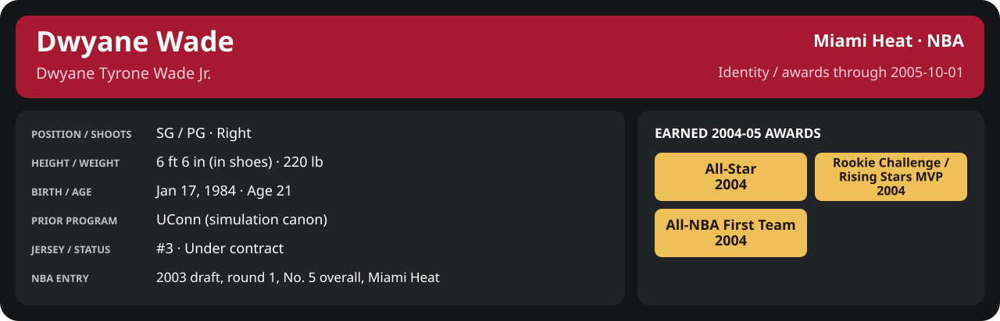

<!-- Generated by scripts/update_player_reports.py; edit source records, then rebuild. -->

# 2004-05 | All-Star weekend

## Professional identity

| Player | Age on report date | Team / league | Position | Number | Status |
| --- | --- | --- | --- | --- | --- |
| Dwyane Tyrone Wade Jr. | 21 | Miami Heat / NBA | SG / PG | 3 | Under contract |

| Identity field | Recorded value |
| --- | --- |
| Birth date | 1984-01-17 |
| NBA entry | 2003 draft, round 1, No. 5 overall, Miami Heat |
| Prior program | UConn (simulation canon) |
| Height, in shoes / without shoes | 6 ft 6 in / 6 ft 4.75 in |
| Weight | 220 lb |
| Wingspan / standing reach | 6 ft 11.5 in / 8 ft 7.5 in |
| Shooting hand | Right |
| Contract | Rookie scale signed 2003-07-21: three seasons plus a 2006-07 team option (2004-05: $2,361,800) |
| Role | Starting SG; staff plan 34 minutes |
| NBA debut | October 28, 2003 at Philadelphia 76ers (2003-04/06_Regular_Season/10_October/Week_4/Game_1.md) |
| Nationality | United States (born in the Chicago area; Robbins, Illinois home community, per the player profile) |
| National team | No selection recorded |
| National-team eligibility | United States (USA Basketball); no selection yet |
| Availability | No current restriction recorded in the established profile |
| Physical measurements recorded | 2003-06-25 |
| Professional status effective | 2004-10-28 |

Identity as of 2005-10-01; status snapshot dated 2004-10-28. User-established alternate-history player; historical Wade's biography and results are not this record.

### Earned 2004-05 awards

| Award | Period | Announced | Decision record |
| --- | --- | --- | --- |
| Eastern Conference Player of the Month | 2004-12-01 to 2004-12-31 | 2005-01-02 | [East POM](../../Stats_and_Awards/League/2004-05/12_December/League_Awards.md#player-of-the-month) |
| Eastern Conference Player of the Week | 2005-01-24 to 2005-01-30 | 2005-01-31 | [East POW](../../Stats_and_Awards/League/2004-05/01_January/Week_4/League_Awards.md#player-of-the-week) |
| All-Star | 2004-11-02 to 2005-02-08 | 2005-02-08 | [All-Star](../../Stats_and_Awards/League/2004-05/All_Star.md#all-stars) |
| Eastern Conference Player of the Month | 2005-03-01 to 2005-03-31 | 2005-04-02 | [East POM](../../Stats_and_Awards/League/2004-05/03_March/League_Awards.md#player-of-the-month) |
| Eastern Conference Player of the Month | 2005-04-01 to 2005-04-20 | 2005-04-22 | [East POM](../../Stats_and_Awards/League/2004-05/04_April/League_Awards.md#player-of-the-month) |
| All-NBA First Team | 2004-11-02 to 2005-04-20 | 2005-05-18 | [All-NBA 1st](../../Stats_and_Awards/League/2004-05/Season_Awards.md#all-nba-teams) |

## Statistics

The Rookie Challenge and the All-Star Game are exhibitions played by the engine; each is its own record, never added to NBA regular-season or playoff totals.

### All-Star weekend games

  

[Shooting detail](../../Stats_and_Awards/Shooting.md) · [Current contract](../../Stats_and_Awards/Contract.md#current-contract) · [Contract history](../../Stats_and_Awards/Contract.md#contract-history) · [Annual award record](../../Stats_and_Awards/Awards.md)

| Scope | Age | Team | Lg | Pos | G | GS | MP | FG | FGA | FG% | 3P | 3PA | 3P% | 2P | 2PA | 2P% | eFG% | FT | FTA | FT% | ORB | DRB | TRB | AST | STL | BLK | TOV | PF | PTS | TS% (est.) | Awards |
| --- | --- | --- | --- | --- | --- | --- | --- | --- | --- | --- | --- | --- | --- | --- | --- | --- | --- | --- | --- | --- | --- | --- | --- | --- | --- | --- | --- | --- | --- | --- | --- |
| [Rookie Challenge](Rookie_Challenge/README.md) | 21 | Sophomores | NBA | SG / PG | 1 | 1 | 27.2 | 8.0 | 11.0 | .727 | 2.0 | 2.0 | 1.000 | 6.0 | 9.0 | .667 | .818 | 2.0 | 2.0 | 1.000 | 1.0 | 3.0 | 4.0 | 4.0 | 4.0 | 2.0 | 4.0 | 3.0 | 20.0 | .842 | [Rising Stars MVP](../../Stats_and_Awards/League/2004-05/All_Star_Games.md#rookie-challenge-mvp) |
| [NBA All-Star Game](All_Star_Game/README.md) | 21 | East | NBA | SG / PG | 1 | 0 | 26.2 | 8.0 | 12.0 | .667 | 0.0 | 2.0 | .000 | 8.0 | 10.0 | .800 | .667 | 3.0 | 3.0 | 1.000 | 2.0 | 4.0 | 6.0 | 3.0 | 2.0 | 1.0 | 1.0 | 1.0 | 19.0 | .713 | — |

G and GS are counts; MP and counting statistics are **per appearance**. Shooting uses **.500 = 50.0%**. Age is at the row's cutoff. Scroll horizontally for every column.

Awards are confirmed through 2006-06-04, filed by the honor's period-end date; the banner shows career awards known at the page's identity cutoff.

### Game log

| Date / source | Opponent | Venue | Result | Participation | MIN | PTS | REB | AST | STL | BLK | TOV |
| --- | --- | --- | --- | --- | --- | --- | --- | --- | --- | --- | --- |
| [2005-02-18](Rookie_Challenge/Game_1.md) | Rookies | neutral | W 120-97 | Played | 27.2 | 20 | 4 | 4 | 4 | 2 | 4 |
| [2005-02-20](All_Star_Game/Game_1.md) | West | neutral | L 134-135 | Played | 26.2 | 19 | 6 | 3 | 2 | 1 | 1 |

### Individual game boxes

| Scope | Age | Team | Lg | Pos | G | GS | MP | FG | FGA | FG% | 3P | 3PA | 3P% | 2P | 2PA | 2P% | eFG% | FT | FTA | FT% | ORB | DRB | TRB | AST | STL | BLK | TOV | PF | PTS | TS% (est.) | Awards |
| --- | --- | --- | --- | --- | --- | --- | --- | --- | --- | --- | --- | --- | --- | --- | --- | --- | --- | --- | --- | --- | --- | --- | --- | --- | --- | --- | --- | --- | --- | --- | --- |
| [2005-02-18](Rookie_Challenge/Game_1.md) | 21 | Sophomores | NBA | SG / PG | 1 | 1 | 27.2 | 8.0 | 11.0 | .727 | 2.0 | 2.0 | 1.000 | 6.0 | 9.0 | .667 | .818 | 2.0 | 2.0 | 1.000 | 1.0 | 3.0 | 4.0 | 4.0 | 4.0 | 2.0 | 4.0 | 3.0 | 20.0 | .842 | — |
| [2005-02-20](All_Star_Game/Game_1.md) | 21 | East | NBA | SG / PG | 1 | 0 | 26.2 | 8.0 | 12.0 | .667 | 0.0 | 2.0 | .000 | 8.0 | 10.0 | .800 | .667 | 3.0 | 3.0 | 1.000 | 2.0 | 4.0 | 6.0 | 3.0 | 2.0 | 1.0 | 1.0 | 1.0 | 19.0 | .713 | — |

G and GS are counts; MP and counting statistics are **per appearance**. Shooting uses **.500 = 50.0%**. Age is at the row's cutoff. Scroll horizontally for every column.

Awards are confirmed through 2006-06-04, filed by the honor's period-end date; the banner shows career awards known at the page's identity cutoff.

### Game shooting detail

| Date / source | FG | 2P | 3P | FT | eFG% | TS% (est.) | +/- | PF |
| --- | --- | --- | --- | --- | --- | --- | --- | --- |
| [2005-02-18](Rookie_Challenge/Game_1.md) | 8/11 | 6/9 | 2/2 | 2/2 | 81.8% | 84.2% | N/A | 3 |
| [2005-02-20](All_Star_Game/Game_1.md) | 8/12 | 8/10 | 0/2 | 3/3 | 66.7% | 71.3% | N/A | 1 |
