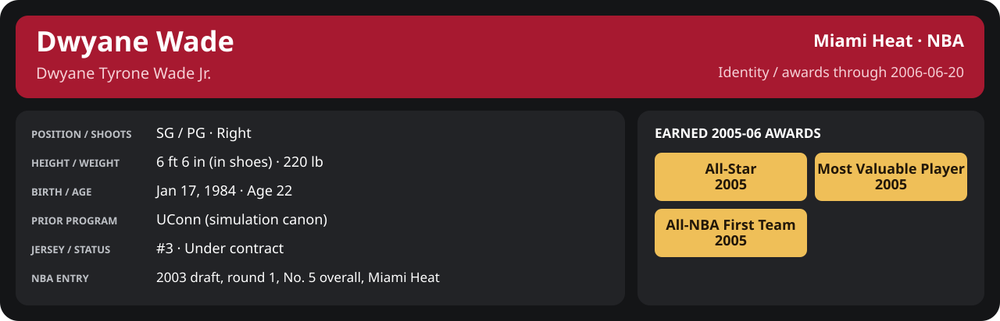

<!-- Generated by scripts/update_player_reports.py; edit source records, then rebuild. -->

# 2005-06 | Conference Finals

[Playoffs](../README.md) · [Career](../../../README.md) · [Professional identity](../../../Professional_Identity.md) · [Earned awards](../../../Awards.md) · [Stat definitions](../../../../../docs/player_statistics.md)

## Professional identity

| Player | Age on report date | Team / league | Position | Number | Status |
| --- | --- | --- | --- | --- | --- |
| Dwyane Tyrone Wade Jr. | 22 | Miami Heat / NBA | SG / PG | 3 | Under contract |

| Identity field | Recorded value |
| --- | --- |
| Birth date | 1984-01-17 |
| NBA entry | 2003 draft, round 1, No. 5 overall, Miami Heat |
| Prior program | UConn (simulation canon) |
| Height, in shoes / without shoes | 6 ft 6 in / 6 ft 4.75 in |
| Weight | 220 lb |
| Wingspan / standing reach | 6 ft 11.5 in / 8 ft 7.5 in |
| Shooting hand | Right |
| Contract | Rookie scale signed 2003-07-21: three seasons plus a 2006-07 team option (2005-06: $2,526,600; 2006-07 team option exercised 2005-10-31 at $3,201,202) |
| Role | Starting SG; staff plan 34 minutes |
| NBA debut | October 28, 2003 at Philadelphia 76ers (2003-04/06_Regular_Season/10_October/Week_4/Game_1.md) |
| Nationality | United States (born in the Chicago area; Robbins, Illinois home community, per the player profile) |
| National team | No selection recorded |
| National-team eligibility | United States (USA Basketball); no selection yet |
| Availability | No current restriction recorded in the established profile |
| Physical measurements recorded | 2003-06-25 |
| Professional status effective | 2005-10-26 |

Identity as of 2006-06-20; status snapshot dated 2005-10-26. User-established alternate-history player; historical Wade's biography and results are not this record.

### Earned 2005-06 awards

| Award | Period | Announced | Decision record |
| --- | --- | --- | --- |
| Eastern Conference Player of the Week | 2005-11-07 to 2005-11-13 | 2005-11-14 | [East POW](../../../Stats_and_Awards/League/2005-06/11_November/Week_2/League_Awards.md#player-of-the-week) |
| Eastern Conference Player of the Week | 2005-11-14 to 2005-11-20 | 2005-11-21 | [East POW](../../../Stats_and_Awards/League/2005-06/11_November/Week_3/League_Awards.md#player-of-the-week) |
| Eastern Conference Player of the Month | 2005-11-01 to 2005-11-30 | 2005-12-02 | [East POM](../../../Stats_and_Awards/League/2005-06/11_November/League_Awards.md#player-of-the-month) |
| Eastern Conference Player of the Week | 2005-11-28 to 2005-12-04 | 2005-12-05 | [East POW](../../../Stats_and_Awards/League/2005-06/12_December/Week_1/League_Awards.md#player-of-the-week) |
| Eastern Conference Player of the Week | 2005-12-05 to 2005-12-11 | 2005-12-12 | [East POW](../../../Stats_and_Awards/League/2005-06/12_December/Week_2/League_Awards.md#player-of-the-week) |
| Eastern Conference Player of the Week | 2005-12-26 to 2006-01-01 | 2006-01-02 | [East POW](../../../Stats_and_Awards/League/2005-06/01_January/Week_1/League_Awards.md#player-of-the-week) |
| All-Star | 2005-11-01 to 2006-02-02 | 2006-02-02 | [All-Star](../../../Stats_and_Awards/League/2005-06/All_Star.md#all-stars) |
| Eastern Conference Player of the Month | 2006-01-01 to 2006-01-31 | 2006-02-02 | [East POM](../../../Stats_and_Awards/League/2005-06/01_January/League_Awards.md#player-of-the-month) |
| Eastern Conference Player of the Month | 2006-02-01 to 2006-02-28 | 2006-03-02 | [East POM](../../../Stats_and_Awards/League/2005-06/02_February/League_Awards.md#player-of-the-month) |
| Eastern Conference Player of the Week | 2006-03-13 to 2006-03-19 | 2006-03-20 | [East POW](../../../Stats_and_Awards/League/2005-06/03_March/Week_3/League_Awards.md#player-of-the-week) |
| Eastern Conference Player of the Month | 2006-03-01 to 2006-03-31 | 2006-04-02 | [East POM](../../../Stats_and_Awards/League/2005-06/03_March/League_Awards.md#player-of-the-month) |
| Most Valuable Player | 2005-11-01 to 2006-04-19 | 2006-05-07 | [MVP](../../../Stats_and_Awards/League/2005-06/Season_Awards.md#most-valuable-player) |
| All-NBA First Team | 2005-11-01 to 2006-04-19 | 2006-05-17 | [All-NBA 1st](../../../Stats_and_Awards/League/2005-06/Season_Awards.md#all-nba-teams) |

## Statistics

As of **2006-06-20**: 7 closed games; 7/7 have player participation and box coverage; recorded DNPs: 0.

G counts appearances; GS counts recorded starts. DNPs, scheduled games and canceled games do not enter per-game denominators.

### Per game

  

[Shooting detail](../../../Stats_and_Awards/Shooting.md) · [Current contract](../../../Stats_and_Awards/Contract.md#current-contract) · [Contract history](../../../Stats_and_Awards/Contract.md#contract-history) · [Annual award record](../../../Stats_and_Awards/Awards.md)

| Scope | Age | Team | Lg | Pos | G | GS | MP | FG | FGA | FG% | 3P | 3PA | 3P% | 2P | 2PA | 2P% | eFG% | FT | FTA | FT% | ORB | DRB | TRB | AST | STL | BLK | TOV | PF | PTS | TS% (est.) | Awards |
| --- | --- | --- | --- | --- | --- | --- | --- | --- | --- | --- | --- | --- | --- | --- | --- | --- | --- | --- | --- | --- | --- | --- | --- | --- | --- | --- | --- | --- | --- | --- | --- |
| This scope | 22 | Miami Heat | NBA | SG / PG | 7 | 7 | 35.4 | 10.0 | 17.1 | .583 | 1.1 | 2.1 | .533 | 8.9 | 15.0 | .590 | .617 | 6.6 | 7.0 | .939 | 1.1 | 3.6 | 4.7 | 3.3 | 1.4 | 1.6 | 1.0 | 3.3 | 27.7 | .685 | — |

G and GS are counts; MP and counting statistics are **per appearance**. Shooting uses **.500 = 50.0%**. Age is at the row's cutoff. Scroll horizontally for every column.

Awards are confirmed through 2006-06-20, filed by the honor's period-end date; the banner shows career awards known at the page's identity cutoff.

[Full statistical detail: totals, per 36, shooting, efficiency, splits and source games](Stat_Detail.md)

### Production

| Metric | Total | Per appearance | Per 36 minutes |
| --- | --- | --- | --- |
| MIN | 247.6 | 35.4 | 36.0 |
| PTS | 194 | 27.7 | 28.2 |
| OREB | 8 | 1.1 | 1.2 |
| DREB | 25 | 3.6 | 3.6 |
| REB | 33 | 4.7 | 4.8 |
| AST | 23 | 3.3 | 3.3 |
| STL | 10 | 1.4 | 1.5 |
| BLK | 11 | 1.6 | 1.6 |
| TOV | 7 | 1.0 | 1.0 |
| PF | 23 | 3.3 | 3.3 |
| FGM | 70 | 10.0 | 10.2 |
| FGA | 120 | 17.1 | 17.4 |
| 2PM | 62 | 8.9 | 9.0 |
| 2PA | 105 | 15.0 | 15.3 |
| 3PM | 8 | 1.1 | 1.2 |
| 3PA | 15 | 2.1 | 2.2 |
| FTM | 46 | 6.6 | 6.7 |
| FTA | 49 | 7.0 | 7.1 |
| FT points | 46 | 6.6 | 6.7 |

Per-36 rates standardize playing time; they are not a projection of playing 36 minutes. Use the actual minutes denominator in every competition.

### Shooting

| Shot type | Makes | Attempts | Percentage |
| --- | --- | --- | --- |
| All field goals | 70 | 120 | 58.3% |
| Two-pointers | 62 | 105 | 59.0% |
| Three-pointers | 8 | 15 | 53.3% |
| Free throws | 46 | 49 | 93.9% |

### Efficiency and shot selection

| Metric | Value | Calculation / unit |
| --- | --- | --- |
| eFG% | 61.7% | (FGM + 0.5 × 3PM) / FGA |
| TS% (estimated) | 68.5% | PTS / [2 × (FGA + 0.44 × FTA)] |
| Three-point attempt share | 12.5% | 3PA / FGA |
| Free-throw attempt rate | 0.408 | FTA / FGA; ratio |
| Assist / turnover ratio | 3.29 | AST / TOV; N/A at zero turnovers |
| Plus/minus total | N/A | Observed on-court score differential only |
| Double-doubles | 0 | At least 10 in any two of PTS, REB, AST, STL, BLK |
| Triple-doubles | 0 | At least 10 in any three; also included in double-doubles |

Percentages use pooled makes and attempts. TS% uses an estimated free-throw weighting, not exact scoring possessions. Rounding is display-only.

### Splits

  

[Shooting detail](../../../Stats_and_Awards/Shooting.md) · [Current contract](../../../Stats_and_Awards/Contract.md#current-contract) · [Contract history](../../../Stats_and_Awards/Contract.md#contract-history) · [Annual award record](../../../Stats_and_Awards/Awards.md)

| Scope | Age | Team | Lg | Pos | G | GS | MP | FG | FGA | FG% | 3P | 3PA | 3P% | 2P | 2PA | 2P% | eFG% | FT | FTA | FT% | ORB | DRB | TRB | AST | STL | BLK | TOV | PF | PTS | TS% (est.) | Awards |
| --- | --- | --- | --- | --- | --- | --- | --- | --- | --- | --- | --- | --- | --- | --- | --- | --- | --- | --- | --- | --- | --- | --- | --- | --- | --- | --- | --- | --- | --- | --- | --- |
| Home | 22 | Miami Heat | NBA | SG / PG | 3 | 3 | 31.8 | 7.0 | 13.3 | .525 | 1.3 | 2.3 | .571 | 5.7 | 11.0 | .515 | .575 | 6.0 | 6.3 | .947 | 0.7 | 3.7 | 4.3 | 4.0 | 0.7 | 1.3 | 1.3 | 4.7 | 21.3 | .662 | — |
| Away | 22 | Miami Heat | NBA | SG / PG | 4 | 4 | 38.1 | 12.2 | 20.0 | .613 | 1.0 | 2.0 | .500 | 11.2 | 18.0 | .625 | .637 | 7.0 | 7.5 | .933 | 1.5 | 3.5 | 5.0 | 2.8 | 2.0 | 1.8 | 0.8 | 2.2 | 32.5 | .697 | — |
| Neutral | 22 | Miami Heat | NBA | SG / PG | 0 | N/A | N/A | N/A | N/A | N/A | N/A | N/A | N/A | N/A | N/A | N/A | N/A | N/A | N/A | N/A | N/A | N/A | N/A | N/A | N/A | N/A | N/A | N/A | N/A | N/A | — |
| Wins | 22 | Miami Heat | NBA | SG / PG | 3 | 3 | 41.1 | 9.7 | 17.7 | .547 | 1.3 | 3.0 | .444 | 8.3 | 14.7 | .568 | .585 | 9.0 | 9.0 | 1.000 | 1.3 | 5.3 | 6.7 | 4.0 | 2.3 | 1.7 | 1.3 | 2.7 | 29.7 | .686 | — |
| Losses | 22 | Miami Heat | NBA | SG / PG | 4 | 4 | 31.1 | 10.2 | 16.8 | .612 | 1.0 | 1.5 | .667 | 9.2 | 15.2 | .607 | .642 | 4.8 | 5.5 | .864 | 1.0 | 2.2 | 3.2 | 2.8 | 0.8 | 1.5 | 0.8 | 3.8 | 26.2 | .685 | — |
| Team: Miami Heat | 22 | Miami Heat | NBA | SG / PG | 7 | 7 | 35.4 | 10.0 | 17.1 | .583 | 1.1 | 2.1 | .533 | 8.9 | 15.0 | .590 | .617 | 6.6 | 7.0 | .939 | 1.1 | 3.6 | 4.7 | 3.3 | 1.4 | 1.6 | 1.0 | 3.3 | 27.7 | .685 | — |

G and GS are counts; MP and counting statistics are **per appearance**. Shooting uses **.500 = 50.0%**. Age is at the row's cutoff. Scroll horizontally for every column.

Awards are confirmed through 2006-06-20, filed by the honor's period-end date; the banner shows career awards known at the page's identity cutoff.

Splits overlap and are not additive. Each row has its own appearance denominator; games with unknown result classification are excluded from win/loss splits.

### Game highs

| Metric | High | Date / opponent (all ties) |
| --- | --- | --- |
| PTS | 52 | [2006-06-04 at Toronto Raptors](Game_7.md) |
| REB | 8 | [2006-05-27 vs Toronto Raptors](Game_3.md) |
| AST | 6 | [2006-05-29 vs Toronto Raptors](Game_4.md) |
| STL | 5 | [2006-05-31 at Toronto Raptors](Game_5.md) |
| BLK | 4 | [2006-06-04 at Toronto Raptors](Game_7.md) |
| TOV | 2 | [2006-05-25 at Toronto Raptors](Game_2.md); [2006-05-27 vs Toronto Raptors](Game_3.md); [2006-05-29 vs Toronto Raptors](Game_4.md) |

### Game log

| Date / source | Opponent | Venue | Result | Participation | MIN | PTS | REB | AST | STL | BLK | TOV |
| --- | --- | --- | --- | --- | --- | --- | --- | --- | --- | --- | --- |
| [2006-05-23](Game_1.md) | Toronto Raptors | away | L 99-127 | Played | 27.3 | 18 | 2 | 4 | 0 | 0 | 0 |
| [2006-05-25](Game_2.md) | Toronto Raptors | away | L 88-111 | Played | 40.4 | 24 | 5 | 2 | 0 | 2 | 2 |
| [2006-05-27](Game_3.md) | Toronto Raptors | home | W 110-102 | Played | 40.2 | 36 | 8 | 2 | 2 | 3 | 2 |
| [2006-05-29](Game_4.md) | Toronto Raptors | home | W 108-94 | Played | 40.6 | 17 | 5 | 6 | 0 | 1 | 2 |
| [2006-05-31](Game_5.md) | Toronto Raptors | away | W 99-98 | Played | 42.6 | 36 | 7 | 4 | 5 | 1 | 0 |
| [2006-06-02](Game_6.md) | Toronto Raptors | home | L 112-114 | Played | 14.6 | 11 | 0 | 4 | 0 | 0 | 0 |
| [2006-06-04](Game_7.md) | Toronto Raptors | away | L 110-118 | Played | 41.9 | 52 | 6 | 1 | 3 | 4 | 1 |

### Individual game boxes

| Scope | Age | Team | Lg | Pos | G | GS | MP | FG | FGA | FG% | 3P | 3PA | 3P% | 2P | 2PA | 2P% | eFG% | FT | FTA | FT% | ORB | DRB | TRB | AST | STL | BLK | TOV | PF | PTS | TS% (est.) | Awards |
| --- | --- | --- | --- | --- | --- | --- | --- | --- | --- | --- | --- | --- | --- | --- | --- | --- | --- | --- | --- | --- | --- | --- | --- | --- | --- | --- | --- | --- | --- | --- | --- |
| [2006-05-23](Game_1.md) | 22 | Miami Heat | NBA | SG / PG | 1 | 1 | 27.3 | 9.0 | 13.0 | .692 | 0.0 | 1.0 | .000 | 9.0 | 12.0 | .750 | .692 | 0.0 | 2.0 | .000 | 1.0 | 1.0 | 2.0 | 4.0 | 0.0 | 0.0 | 0.0 | 3.0 | 18.0 | .648 | — |
| [2006-05-25](Game_2.md) | 22 | Miami Heat | NBA | SG / PG | 1 | 1 | 40.4 | 10.0 | 17.0 | .588 | 0.0 | 0.0 | N/A | 10.0 | 17.0 | .588 | .588 | 4.0 | 4.0 | 1.000 | 1.0 | 4.0 | 5.0 | 2.0 | 0.0 | 2.0 | 2.0 | 0.0 | 24.0 | .640 | — |
| [2006-05-27](Game_3.md) | 22 | Miami Heat | NBA | SG / PG | 1 | 1 | 40.2 | 11.0 | 20.0 | .550 | 2.0 | 4.0 | .500 | 9.0 | 16.0 | .562 | .600 | 12.0 | 12.0 | 1.000 | 1.0 | 7.0 | 8.0 | 2.0 | 2.0 | 3.0 | 2.0 | 5.0 | 36.0 | .712 | — |
| [2006-05-29](Game_4.md) | 22 | Miami Heat | NBA | SG / PG | 1 | 1 | 40.6 | 7.0 | 12.0 | .583 | 1.0 | 2.0 | .500 | 6.0 | 10.0 | .600 | .625 | 2.0 | 2.0 | 1.000 | 1.0 | 4.0 | 5.0 | 6.0 | 0.0 | 1.0 | 2.0 | 3.0 | 17.0 | .660 | — |
| [2006-05-31](Game_5.md) | 22 | Miami Heat | NBA | SG / PG | 1 | 1 | 42.6 | 11.0 | 21.0 | .524 | 1.0 | 3.0 | .333 | 10.0 | 18.0 | .556 | .548 | 13.0 | 13.0 | 1.000 | 2.0 | 5.0 | 7.0 | 4.0 | 5.0 | 1.0 | 0.0 | 0.0 | 36.0 | .674 | — |
| [2006-06-02](Game_6.md) | 22 | Miami Heat | NBA | SG / PG | 1 | 1 | 14.6 | 3.0 | 8.0 | .375 | 1.0 | 1.0 | 1.000 | 2.0 | 7.0 | .286 | .438 | 4.0 | 5.0 | .800 | 0.0 | 0.0 | 0.0 | 4.0 | 0.0 | 0.0 | 0.0 | 6.0 | 11.0 | .539 | — |
| [2006-06-04](Game_7.md) | 22 | Miami Heat | NBA | SG / PG | 1 | 1 | 41.9 | 19.0 | 29.0 | .655 | 3.0 | 4.0 | .750 | 16.0 | 25.0 | .640 | .707 | 11.0 | 11.0 | 1.000 | 2.0 | 4.0 | 6.0 | 1.0 | 3.0 | 4.0 | 1.0 | 6.0 | 52.0 | .768 | — |

G and GS are counts; MP and counting statistics are **per appearance**. Shooting uses **.500 = 50.0%**. Age is at the row's cutoff. Scroll horizontally for every column.

Awards are confirmed through 2006-06-20, filed by the honor's period-end date; the banner shows career awards known at the page's identity cutoff.

### Game shooting detail

| Date / source | FG | 2P | 3P | FT | eFG% | TS% (est.) | +/- | PF |
| --- | --- | --- | --- | --- | --- | --- | --- | --- |
| [2006-05-23](Game_1.md) | 9/13 | 9/12 | 0/1 | 0/2 | 69.2% | 64.8% | N/A | 3 |
| [2006-05-25](Game_2.md) | 10/17 | 10/17 | 0/0 | 4/4 | 58.8% | 64.0% | N/A | 0 |
| [2006-05-27](Game_3.md) | 11/20 | 9/16 | 2/4 | 12/12 | 60.0% | 71.2% | N/A | 5 |
| [2006-05-29](Game_4.md) | 7/12 | 6/10 | 1/2 | 2/2 | 62.5% | 66.0% | N/A | 3 |
| [2006-05-31](Game_5.md) | 11/21 | 10/18 | 1/3 | 13/13 | 54.8% | 67.4% | N/A | 0 |
| [2006-06-02](Game_6.md) | 3/8 | 2/7 | 1/1 | 4/5 | 43.8% | 53.9% | N/A | 6 |
| [2006-06-04](Game_7.md) | 19/29 | 16/25 | 3/4 | 11/11 | 70.7% | 76.8% | N/A | 6 |

### Additional data needed

| Statistic family | Current support | Required evidence |
| --- | --- | --- |
| Starts; plus/minus | N/A unless supplied in the player box | Explicit started and plus_minus fields |
| Per 100 possessions; offensive / defensive / net rating | Unavailable in current box feed | Player on-court possessions and both teams' scoring during those possessions |
| USG%; AST%; OREB%, DREB%, REB% | Unavailable in current box feed | Matching player/team/opponent opportunity counts and a declared method |
| Rim, paint, midrange, corner / above-break threes | Unavailable in current box feed | Shot locations, attempts and makes |
| Drives, touches, catch-and-shoot, pull-ups, play types | Unavailable in current box feed | Tracking or tagged play-by-play |
| Clutch, on/off, lineup combinations, assisted baskets | Unavailable in current box feed | Timed events, score state, substitutions and possession attribution |
| Deflections, charges, contested shots, box outs | Unavailable in current box feed | Observed hustle/defensive events |
| League rank, percentile, relative TS%; impact models | Not derived by this report | Same-period simulated league baseline, eligibility rules and documented model |
