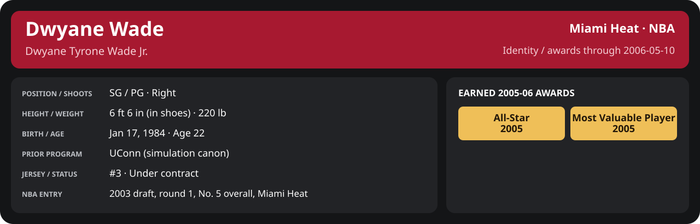

<!-- Generated by scripts/update_player_reports.py; edit source records, then rebuild. -->

# 2005-06 | NBA playoffs

[Career](../../README.md) · [Professional identity](../../Professional_Identity.md) · [Earned awards](../../Awards.md) · [Stat definitions](../../../../docs/player_statistics.md)

## Professional identity

| Player | Age on report date | Team / league | Position | Number | Status |
| --- | --- | --- | --- | --- | --- |
| Dwyane Tyrone Wade Jr. | 22 | Miami Heat / NBA | SG / PG | 3 | Under contract |

| Identity field | Recorded value |
| --- | --- |
| Birth date | 1984-01-17 |
| NBA entry | 2003 draft, round 1, No. 5 overall, Miami Heat |
| Prior program | UConn (simulation canon) |
| Height, in shoes / without shoes | 6 ft 6 in / 6 ft 4.75 in |
| Weight | 220 lb |
| Wingspan / standing reach | 6 ft 11.5 in / 8 ft 7.5 in |
| Shooting hand | Right |
| Contract | Rookie scale signed 2003-07-21: three seasons plus a 2006-07 team option (2005-06: $2,526,600; 2006-07 team option exercised 2005-10-31 at $3,201,202) |
| Role | Starting SG; staff plan 34 minutes |
| NBA debut | October 28, 2003 at Philadelphia 76ers (2003-04/06_Regular_Season/10_October/Week_4/Game_1.md) |
| Nationality | United States (born in the Chicago area; Robbins, Illinois home community, per the player profile) |
| National team | No selection recorded |
| National-team eligibility | United States (USA Basketball); no selection yet |
| Availability | No current restriction recorded in the established profile |
| Physical measurements recorded | 2003-06-25 |
| Professional status effective | 2005-10-26 |

Identity as of 2006-05-10; status snapshot dated 2005-10-26. User-established alternate-history player; historical Wade's biography and results are not this record.

### Earned 2005-06 awards

| Award | Period | Announced | Decision record |
| --- | --- | --- | --- |
| Eastern Conference Player of the Week | 2005-11-07 to 2005-11-13 | 2005-11-14 | [East POW](../../Stats_and_Awards/League/2005-06/11_November/Week_2/League_Awards.md#player-of-the-week) |
| Eastern Conference Player of the Week | 2005-11-14 to 2005-11-20 | 2005-11-21 | [East POW](../../Stats_and_Awards/League/2005-06/11_November/Week_3/League_Awards.md#player-of-the-week) |
| Eastern Conference Player of the Month | 2005-11-01 to 2005-11-30 | 2005-12-02 | [East POM](../../Stats_and_Awards/League/2005-06/11_November/League_Awards.md#player-of-the-month) |
| Eastern Conference Player of the Week | 2005-11-28 to 2005-12-04 | 2005-12-05 | [East POW](../../Stats_and_Awards/League/2005-06/12_December/Week_1/League_Awards.md#player-of-the-week) |
| Eastern Conference Player of the Week | 2005-12-05 to 2005-12-11 | 2005-12-12 | [East POW](../../Stats_and_Awards/League/2005-06/12_December/Week_2/League_Awards.md#player-of-the-week) |
| Eastern Conference Player of the Week | 2005-12-26 to 2006-01-01 | 2006-01-02 | [East POW](../../Stats_and_Awards/League/2005-06/01_January/Week_1/League_Awards.md#player-of-the-week) |
| All-Star | 2005-11-01 to 2006-02-02 | 2006-02-02 | [All-Star](../../Stats_and_Awards/League/2005-06/All_Star.md#all-stars) |
| Eastern Conference Player of the Month | 2006-01-01 to 2006-01-31 | 2006-02-02 | [East POM](../../Stats_and_Awards/League/2005-06/01_January/League_Awards.md#player-of-the-month) |
| Eastern Conference Player of the Month | 2006-02-01 to 2006-02-28 | 2006-03-02 | [East POM](../../Stats_and_Awards/League/2005-06/02_February/League_Awards.md#player-of-the-month) |
| Eastern Conference Player of the Week | 2006-03-13 to 2006-03-19 | 2006-03-20 | [East POW](../../Stats_and_Awards/League/2005-06/03_March/Week_3/League_Awards.md#player-of-the-week) |
| Eastern Conference Player of the Month | 2006-03-01 to 2006-03-31 | 2006-04-02 | [East POM](../../Stats_and_Awards/League/2005-06/03_March/League_Awards.md#player-of-the-month) |
| Most Valuable Player | 2005-11-01 to 2006-04-19 | 2006-05-07 | [MVP](../../Stats_and_Awards/League/2005-06/Season_Awards.md#most-valuable-player) |

## Statistics

As of **2006-05-10**: 6 closed games; 6/6 have player participation and box coverage; recorded DNPs: 0.

G counts appearances; GS counts recorded starts. DNPs, scheduled games and canceled games do not enter per-game denominators.

### Per game

  

[Shooting detail](../../Stats_and_Awards/Shooting.md) · [Current contract](../../Stats_and_Awards/Contract.md#current-contract) · [Contract history](../../Stats_and_Awards/Contract.md#contract-history) · [Annual award record](../../Stats_and_Awards/Awards.md)

| Scope | Age | Team | Lg | Pos | G | GS | MP | FG | FGA | FG% | 3P | 3PA | 3P% | 2P | 2PA | 2P% | eFG% | FT | FTA | FT% | ORB | DRB | TRB | AST | STL | BLK | TOV | PF | PTS | TS% (est.) | Awards |
| --- | --- | --- | --- | --- | --- | --- | --- | --- | --- | --- | --- | --- | --- | --- | --- | --- | --- | --- | --- | --- | --- | --- | --- | --- | --- | --- | --- | --- | --- | --- | --- |
| This scope | 22 | Miami Heat | NBA | SG / PG | 6 | 6 | 33.2 | 8.3 | 13.3 | .625 | 0.8 | 1.7 | .500 | 7.5 | 11.7 | .643 | .656 | 4.5 | 4.7 | .964 | 1.3 | 4.0 | 5.3 | 4.3 | 0.7 | 1.2 | 2.3 | 3.2 | 22.0 | .715 | — |

G and GS are counts; MP and counting statistics are **per appearance**. Shooting uses **.500 = 50.0%**. Age is at the row's cutoff. Scroll horizontally for every column.

Awards are confirmed through 2006-05-10, filed by the honor's period-end date; the banner shows career awards known at the page's identity cutoff.

[Full statistical detail: totals, per 36, shooting, efficiency, splits and source games](Stat_Detail.md)

National and club exhibitions, preseason, Play-In and playoffs stay outside NBA regular-season totals.

### Period summary

  

[Shooting detail](../../Stats_and_Awards/Shooting.md) · [Current contract](../../Stats_and_Awards/Contract.md#current-contract) · [Contract history](../../Stats_and_Awards/Contract.md#contract-history) · [Annual award record](../../Stats_and_Awards/Awards.md)

| Scope | Age | Team | Lg | Pos | G | GS | MP | FG | FGA | FG% | 3P | 3PA | 3P% | 2P | 2PA | 2P% | eFG% | FT | FTA | FT% | ORB | DRB | TRB | AST | STL | BLK | TOV | PF | PTS | TS% (est.) | Awards |
| --- | --- | --- | --- | --- | --- | --- | --- | --- | --- | --- | --- | --- | --- | --- | --- | --- | --- | --- | --- | --- | --- | --- | --- | --- | --- | --- | --- | --- | --- | --- | --- |
| [First Round](First_Round/README.md) | 22 | Miami Heat | NBA | SG / PG | 5 | 5 | 33.0 | 8.0 | 13.2 | .606 | 1.0 | 1.6 | .625 | 7.0 | 11.6 | .603 | .644 | 3.6 | 3.8 | .947 | 1.4 | 4.2 | 5.6 | 4.0 | 0.6 | 1.2 | 2.2 | 3.0 | 20.6 | .693 | — |
| [Conference Semifinals](Conference_Semifinals/README.md) | 22 | Miami Heat | NBA | SG / PG | 1 | 1 | 34.0 | 10.0 | 14.0 | .714 | 0.0 | 2.0 | .000 | 10.0 | 12.0 | .833 | .714 | 9.0 | 9.0 | 1.000 | 1.0 | 3.0 | 4.0 | 6.0 | 1.0 | 1.0 | 3.0 | 4.0 | 29.0 | .807 | — |
| [Conference Finals](Conference_Finals/README.md) | 22 | Miami Heat | NBA | SG / PG | 0 | N/A | N/A | N/A | N/A | N/A | N/A | N/A | N/A | N/A | N/A | N/A | N/A | N/A | N/A | N/A | N/A | N/A | N/A | N/A | N/A | N/A | N/A | N/A | N/A | N/A | — |
| [Finals](Finals/README.md) | 22 | Miami Heat | NBA | SG / PG | 0 | N/A | N/A | N/A | N/A | N/A | N/A | N/A | N/A | N/A | N/A | N/A | N/A | N/A | N/A | N/A | N/A | N/A | N/A | N/A | N/A | N/A | N/A | N/A | N/A | N/A | — |

G and GS are counts; MP and counting statistics are **per appearance**. Shooting uses **.500 = 50.0%**. Age is at the row's cutoff. Scroll horizontally for every column.

Awards are confirmed through 2006-05-10, filed by the honor's period-end date; the banner shows career awards known at the page's identity cutoff.

### Production

| Metric | Total | Per appearance | Per 36 minutes |
| --- | --- | --- | --- |
| MIN | 198.9 | 33.2 | 36.0 |
| PTS | 132 | 22.0 | 23.9 |
| OREB | 8 | 1.3 | 1.4 |
| DREB | 24 | 4.0 | 4.3 |
| REB | 32 | 5.3 | 5.8 |
| AST | 26 | 4.3 | 4.7 |
| STL | 4 | 0.7 | 0.7 |
| BLK | 7 | 1.2 | 1.3 |
| TOV | 14 | 2.3 | 2.5 |
| PF | 19 | 3.2 | 3.4 |
| FGM | 50 | 8.3 | 9.0 |
| FGA | 80 | 13.3 | 14.5 |
| 2PM | 45 | 7.5 | 8.1 |
| 2PA | 70 | 11.7 | 12.7 |
| 3PM | 5 | 0.8 | 0.9 |
| 3PA | 10 | 1.7 | 1.8 |
| FTM | 27 | 4.5 | 4.9 |
| FTA | 28 | 4.7 | 5.1 |
| FT points | 27 | 4.5 | 4.9 |

Per-36 rates standardize playing time; they are not a projection of playing 36 minutes. Use the actual minutes denominator in every competition.

### Shooting

| Shot type | Makes | Attempts | Percentage |
| --- | --- | --- | --- |
| All field goals | 50 | 80 | 62.5% |
| Two-pointers | 45 | 70 | 64.3% |
| Three-pointers | 5 | 10 | 50.0% |
| Free throws | 27 | 28 | 96.4% |

### Efficiency and shot selection

| Metric | Value | Calculation / unit |
| --- | --- | --- |
| eFG% | 65.6% | (FGM + 0.5 × 3PM) / FGA |
| TS% (estimated) | 71.5% | PTS / [2 × (FGA + 0.44 × FTA)] |
| Three-point attempt share | 12.5% | 3PA / FGA |
| Free-throw attempt rate | 0.350 | FTA / FGA; ratio |
| Assist / turnover ratio | 1.86 | AST / TOV; N/A at zero turnovers |
| Plus/minus total | N/A | Observed on-court score differential only |
| Double-doubles | 0 | At least 10 in any two of PTS, REB, AST, STL, BLK |
| Triple-doubles | 0 | At least 10 in any three; also included in double-doubles |

Percentages use pooled makes and attempts. TS% uses an estimated free-throw weighting, not exact scoring possessions. Rounding is display-only.

### Splits

  

[Shooting detail](../../Stats_and_Awards/Shooting.md) · [Current contract](../../Stats_and_Awards/Contract.md#current-contract) · [Contract history](../../Stats_and_Awards/Contract.md#contract-history) · [Annual award record](../../Stats_and_Awards/Awards.md)

| Scope | Age | Team | Lg | Pos | G | GS | MP | FG | FGA | FG% | 3P | 3PA | 3P% | 2P | 2PA | 2P% | eFG% | FT | FTA | FT% | ORB | DRB | TRB | AST | STL | BLK | TOV | PF | PTS | TS% (est.) | Awards |
| --- | --- | --- | --- | --- | --- | --- | --- | --- | --- | --- | --- | --- | --- | --- | --- | --- | --- | --- | --- | --- | --- | --- | --- | --- | --- | --- | --- | --- | --- | --- | --- |
| Home | 22 | Miami Heat | NBA | SG / PG | 4 | 4 | 28.3 | 8.0 | 11.2 | .711 | 1.0 | 1.8 | .571 | 7.0 | 9.5 | .737 | .756 | 4.2 | 4.2 | 1.000 | 1.2 | 3.5 | 4.8 | 4.5 | 0.8 | 1.0 | 2.8 | 4.0 | 21.2 | .810 | — |
| Away | 22 | Miami Heat | NBA | SG / PG | 2 | 2 | 42.8 | 9.0 | 17.5 | .514 | 0.5 | 1.5 | .333 | 8.5 | 16.0 | .531 | .529 | 5.0 | 5.5 | .909 | 1.5 | 5.0 | 6.5 | 4.0 | 0.5 | 1.5 | 1.5 | 1.5 | 23.5 | .590 | — |
| Neutral | 22 | Miami Heat | NBA | SG / PG | 0 | N/A | N/A | N/A | N/A | N/A | N/A | N/A | N/A | N/A | N/A | N/A | N/A | N/A | N/A | N/A | N/A | N/A | N/A | N/A | N/A | N/A | N/A | N/A | N/A | N/A | — |
| Wins | 22 | Miami Heat | NBA | SG / PG | 5 | 5 | 31.1 | 8.8 | 12.8 | .688 | 1.0 | 1.8 | .556 | 7.8 | 11.0 | .709 | .727 | 4.6 | 4.8 | .958 | 1.4 | 3.6 | 5.0 | 4.0 | 0.8 | 1.2 | 2.4 | 3.2 | 23.2 | .778 | — |
| Losses | 22 | Miami Heat | NBA | SG / PG | 1 | 1 | 43.4 | 6.0 | 16.0 | .375 | 0.0 | 1.0 | .000 | 6.0 | 15.0 | .400 | .375 | 4.0 | 4.0 | 1.000 | 1.0 | 6.0 | 7.0 | 6.0 | 0.0 | 1.0 | 2.0 | 3.0 | 16.0 | .450 | — |
| Team: Miami Heat | 22 | Miami Heat | NBA | SG / PG | 6 | 6 | 33.2 | 8.3 | 13.3 | .625 | 0.8 | 1.7 | .500 | 7.5 | 11.7 | .643 | .656 | 4.5 | 4.7 | .964 | 1.3 | 4.0 | 5.3 | 4.3 | 0.7 | 1.2 | 2.3 | 3.2 | 22.0 | .715 | — |

G and GS are counts; MP and counting statistics are **per appearance**. Shooting uses **.500 = 50.0%**. Age is at the row's cutoff. Scroll horizontally for every column.

Awards are confirmed through 2006-05-10, filed by the honor's period-end date; the banner shows career awards known at the page's identity cutoff.

Splits overlap and are not additive. Each row has its own appearance denominator; games with unknown result classification are excluded from win/loss splits.

### Game highs

| Metric | High | Date / opponent (all ties) |
| --- | --- | --- |
| PTS | 31 | [2006-04-29 at Orlando Magic](First_Round/Game_3.md); [2006-05-03 vs Orlando Magic](First_Round/Game_5.md) |
| REB | 8 | [2006-05-03 vs Orlando Magic](First_Round/Game_5.md) |
| AST | 8 | [2006-05-03 vs Orlando Magic](First_Round/Game_5.md) |
| STL | 2 | [2006-05-03 vs Orlando Magic](First_Round/Game_5.md) |
| BLK | 2 | [2006-04-29 at Orlando Magic](First_Round/Game_3.md) |
| TOV | 4 | [2006-05-03 vs Orlando Magic](First_Round/Game_5.md) |

### Game log

| Date / source | Opponent | Venue | Result | Participation | MIN | PTS | REB | AST | STL | BLK | TOV |
| --- | --- | --- | --- | --- | --- | --- | --- | --- | --- | --- | --- |
| [2006-04-23](First_Round/Game_1.md) | Orlando Magic | home | W 108-99 | Played | 24.0 | 16 | 4 | 1 | 0 | 1 | 1 |
| [2006-04-26](First_Round/Game_2.md) | Orlando Magic | home | W 115-106 | Played | 18.3 | 9 | 3 | 3 | 0 | 1 | 3 |
| [2006-04-29](First_Round/Game_3.md) | Orlando Magic | away | W 124-116 | Played | 42.2 | 31 | 6 | 2 | 1 | 2 | 1 |
| [2006-05-01](First_Round/Game_4.md) | Orlando Magic | away | L 102-105 | Played | 43.4 | 16 | 7 | 6 | 0 | 1 | 2 |
| [2006-05-03](First_Round/Game_5.md) | Orlando Magic | home | W 124-97 | Played | 37.1 | 31 | 8 | 8 | 2 | 1 | 4 |
| [2006-05-08](Conference_Semifinals/Game_1.md) | New Jersey Nets | home | W 109-105 | Played | 34.0 | 29 | 4 | 6 | 1 | 1 | 3 |

### Individual game boxes

| Scope | Age | Team | Lg | Pos | G | GS | MP | FG | FGA | FG% | 3P | 3PA | 3P% | 2P | 2PA | 2P% | eFG% | FT | FTA | FT% | ORB | DRB | TRB | AST | STL | BLK | TOV | PF | PTS | TS% (est.) | Awards |
| --- | --- | --- | --- | --- | --- | --- | --- | --- | --- | --- | --- | --- | --- | --- | --- | --- | --- | --- | --- | --- | --- | --- | --- | --- | --- | --- | --- | --- | --- | --- | --- |
| [2006-04-23](First_Round/Game_1.md) | 22 | Miami Heat | NBA | SG / PG | 1 | 1 | 24.0 | 5.0 | 8.0 | .625 | 1.0 | 1.0 | 1.000 | 4.0 | 7.0 | .571 | .688 | 5.0 | 5.0 | 1.000 | 1.0 | 3.0 | 4.0 | 1.0 | 0.0 | 1.0 | 1.0 | 5.0 | 16.0 | .784 | — |
| [2006-04-26](First_Round/Game_2.md) | 22 | Miami Heat | NBA | SG / PG | 1 | 1 | 18.3 | 4.0 | 6.0 | .667 | 1.0 | 1.0 | 1.000 | 3.0 | 5.0 | .600 | .750 | 0.0 | 0.0 | N/A | 2.0 | 1.0 | 3.0 | 3.0 | 0.0 | 1.0 | 3.0 | 6.0 | 9.0 | .750 | — |
| [2006-04-29](First_Round/Game_3.md) | 22 | Miami Heat | NBA | SG / PG | 1 | 1 | 42.2 | 12.0 | 19.0 | .632 | 1.0 | 2.0 | .500 | 11.0 | 17.0 | .647 | .658 | 6.0 | 7.0 | .857 | 2.0 | 4.0 | 6.0 | 2.0 | 1.0 | 2.0 | 1.0 | 0.0 | 31.0 | .702 | — |
| [2006-05-01](First_Round/Game_4.md) | 22 | Miami Heat | NBA | SG / PG | 1 | 1 | 43.4 | 6.0 | 16.0 | .375 | 0.0 | 1.0 | .000 | 6.0 | 15.0 | .400 | .375 | 4.0 | 4.0 | 1.000 | 1.0 | 6.0 | 7.0 | 6.0 | 0.0 | 1.0 | 2.0 | 3.0 | 16.0 | .450 | — |
| [2006-05-03](First_Round/Game_5.md) | 22 | Miami Heat | NBA | SG / PG | 1 | 1 | 37.1 | 13.0 | 17.0 | .765 | 2.0 | 3.0 | .667 | 11.0 | 14.0 | .786 | .824 | 3.0 | 3.0 | 1.000 | 1.0 | 7.0 | 8.0 | 8.0 | 2.0 | 1.0 | 4.0 | 1.0 | 31.0 | .846 | — |
| [2006-05-08](Conference_Semifinals/Game_1.md) | 22 | Miami Heat | NBA | SG / PG | 1 | 1 | 34.0 | 10.0 | 14.0 | .714 | 0.0 | 2.0 | .000 | 10.0 | 12.0 | .833 | .714 | 9.0 | 9.0 | 1.000 | 1.0 | 3.0 | 4.0 | 6.0 | 1.0 | 1.0 | 3.0 | 4.0 | 29.0 | .807 | — |

G and GS are counts; MP and counting statistics are **per appearance**. Shooting uses **.500 = 50.0%**. Age is at the row's cutoff. Scroll horizontally for every column.

Awards are confirmed through 2006-05-10, filed by the honor's period-end date; the banner shows career awards known at the page's identity cutoff.

### Game shooting detail

| Date / source | FG | 2P | 3P | FT | eFG% | TS% (est.) | +/- | PF |
| --- | --- | --- | --- | --- | --- | --- | --- | --- |
| [2006-04-23](First_Round/Game_1.md) | 5/8 | 4/7 | 1/1 | 5/5 | 68.8% | 78.4% | N/A | 5 |
| [2006-04-26](First_Round/Game_2.md) | 4/6 | 3/5 | 1/1 | 0/0 | 75.0% | 75.0% | N/A | 6 |
| [2006-04-29](First_Round/Game_3.md) | 12/19 | 11/17 | 1/2 | 6/7 | 65.8% | 70.2% | N/A | 0 |
| [2006-05-01](First_Round/Game_4.md) | 6/16 | 6/15 | 0/1 | 4/4 | 37.5% | 45.0% | N/A | 3 |
| [2006-05-03](First_Round/Game_5.md) | 13/17 | 11/14 | 2/3 | 3/3 | 82.4% | 84.6% | N/A | 1 |
| [2006-05-08](Conference_Semifinals/Game_1.md) | 10/14 | 10/12 | 0/2 | 9/9 | 71.4% | 80.7% | N/A | 4 |

### Additional data needed

| Statistic family | Current support | Required evidence |
| --- | --- | --- |
| Starts; plus/minus | N/A unless supplied in the player box | Explicit started and plus_minus fields |
| Per 100 possessions; offensive / defensive / net rating | Unavailable in current box feed | Player on-court possessions and both teams' scoring during those possessions |
| USG%; AST%; OREB%, DREB%, REB% | Unavailable in current box feed | Matching player/team/opponent opportunity counts and a declared method |
| Rim, paint, midrange, corner / above-break threes | Unavailable in current box feed | Shot locations, attempts and makes |
| Drives, touches, catch-and-shoot, pull-ups, play types | Unavailable in current box feed | Tracking or tagged play-by-play |
| Clutch, on/off, lineup combinations, assisted baskets | Unavailable in current box feed | Timed events, score state, substitutions and possession attribution |
| Deflections, charges, contested shots, box outs | Unavailable in current box feed | Observed hustle/defensive events |
| League rank, percentile, relative TS%; impact models | Not derived by this report | Same-period simulated league baseline, eligibility rules and documented model |
